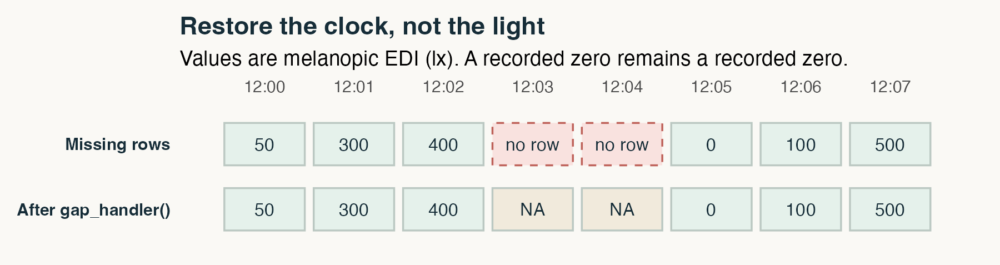
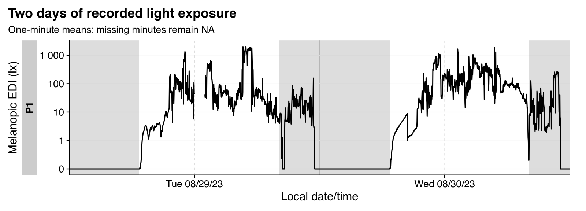
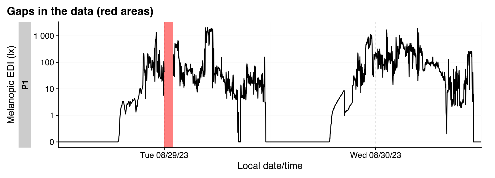
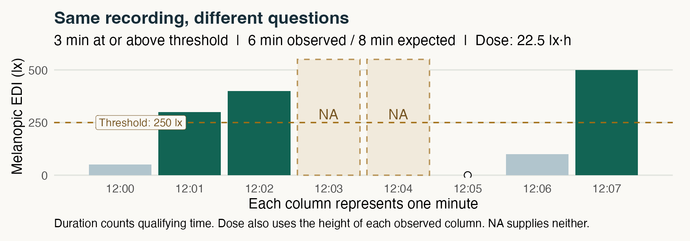
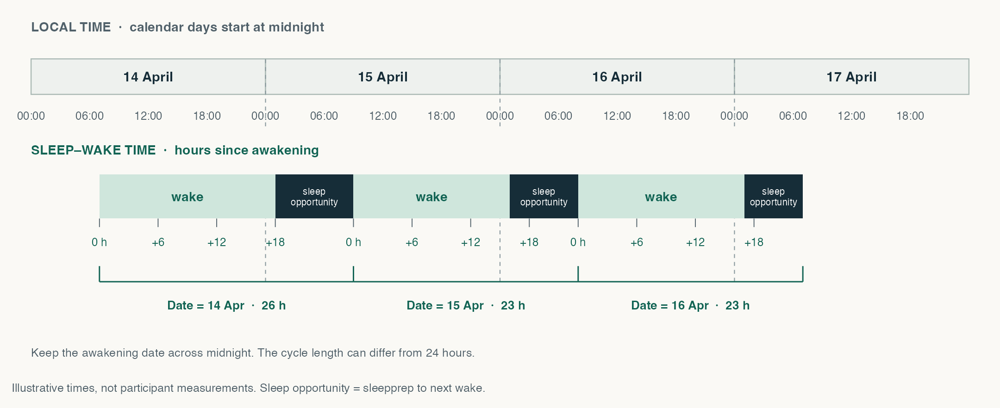
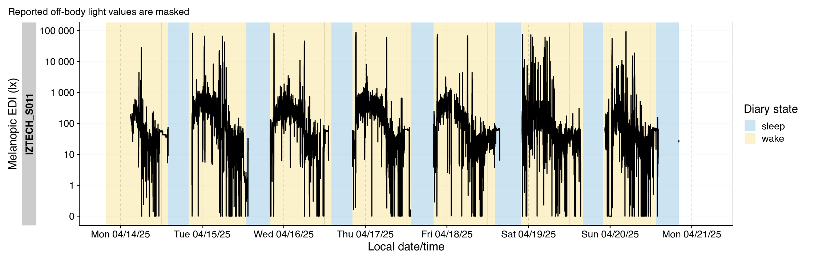



```{=html}
<nav class="mc-toolbar" aria-label="Masterclass controls">
  <a class="mc-wordmark" href="#welcome"> Sleep Europe 2026 <span>MASTERCLASS PERSONAL LIGHT EXPOSURE</span></a>
  <div class="mc-navigation">
    <label class="visually-hidden" for="mc-jump">Workshop chapter</label>
    <select id="mc-jump" aria-label="Workshop chapter"></select>
    <button id="mc-prev" type="button" aria-label="Previous chapter">←</button>
    <button id="mc-next" type="button" aria-label="Next chapter">→</button>
  </div>
  <button id="mc-present" type="button" aria-pressed="false">Present</button>
</nav>
<div class="mc-progress" aria-hidden="true"><span id="mc-progress-fill"></span></div>
<div id="mc-announcement" class="visually-hidden" role="status" aria-live="polite"></div>
```

::: {.mc-page}

::: {#welcome .mc-step data-short="Start here"}
::: {.mc-hero}
::: {.mc-hero-copy}
[Sleep Europe 2026 · Masterclass personal light exposure]{.mc-eyebrow}

## From light data to a reproducible result

::: {.mc-lead}
Make the decisions visible. Run the analysis. Keep the context with the data.
:::

One page to present, experiment, and revisit. We will import a wearable recording with **LightLogR**, make a defensible summary, and combine light and sleep-diary data from a **Global Light Commons** package with **glcdp**.

[Start the workshop ↓](#reproducibility){.mc-primary-link}
[Download the R script](scripts/sleep-europe-masterclass.R){.mc-secondary-link download="sleep-europe-masterclass.R"}

::: {.mc-byline}
**Johannes Zauner** · Technical University of Munich

Beginner level · Browser + internet · No R installation needed
:::
:::

```{=html}
<div class="mc-route" aria-label="Workshop route: raw recording, explicit decisions, interpretable result, reusable data package.">
  <div class="mc-route-label">THE ROUTE</div>
  <div class="mc-route-stop"><span>01</span><div><strong>A recording</strong><small>What did the sensor measure?</small></div></div>
  <div class="mc-route-line"></div>
  <div class="mc-route-stop"><span>02</span><div><strong>A decision trail</strong><small>What did we change, and why?</small></div></div>
  <div class="mc-route-line"></div>
  <div class="mc-route-stop"><span>03</span><div><strong>A result with context</strong><small>What does the number describe?</small></div></div>
  <div class="mc-route-line"></div>
  <div class="mc-route-stop"><span>04</span><div><strong>A reusable package</strong><small>Could someone else start here?</small></div></div>
</div>
```
:::

::: {.mc-orientation}
**Follow along:** work down the page and run the numbered cells in order. **Present:** use the button above to show one chapter at a time. Switching views keeps your code, results, and R objects in this tab. Code changes require rerunning that cell and any later cells that use its results.
:::
:::

::: {#reproducibility .mc-step data-short="01 · Reproducibility"}
[01 / PRINCIPLE]{.mc-eyebrow}

## A result is more than a number

::: {.mc-lead}
“Two hours above a light threshold” is incomplete until we know whose data, which light quantity, which hours, and which processing decisions.
:::

::: {.mc-four-up}
::: {.mc-principle}
[01]{.mc-number}

### Keep the input

Preserve the original recording. Record its source and version. Make a new object for each meaningful transformation.
:::
::: {.mc-principle}
[02]{.mc-number}

### State the decisions

Declare the time zone, analysis window, sampling interval, missing-data rules, and threshold in code.
:::
::: {.mc-principle}
[03]{.mc-number}

### Show the denominator

Report how much time was observed alongside the exposure metric. An unobserved hour is not an hour in darkness.
:::
::: {.mc-principle}
[04]{.mc-number}

### Carry the context

Keep units, sensor placement, preprocessing, and provenance connected to the measurements.
:::
:::

::: {.mc-discuss}
**Discuss:** If two scripts return the same number, does that guarantee they answer the same question?
:::

<details class="mc-notes"><summary>Teaching notes &amp; answer</summary>
Reproducibility means being able to rerun a specified workflow with the specified inputs and environment. It does not establish that the measurement, analysis choice, or interpretation is valid. Ask for one example of a hidden decision before moving on.
</details>
:::

::: {#ready .mc-step data-short="02 · Start R"}
[02 / GET READY]{.mc-eyebrow}

## Your browser is the R session

::: {.mc-split}
::: {.mc-explain}
Wait for **Run Code** to become available, then run the cell. The first load downloads R and the packages; it can take a little while.

The cells share objects. Work from top to bottom. Each browser has its own session, so the presenter and attendees can try different settings.

**Keep this tab open.** Reloading starts a new R session and discards your edits. Copy edited code before leaving; the script download contains the original workshop code.

::: {.mc-task}
**First action:** Run the cell and find the R and LightLogR versions in your output.
:::
:::
::: {.mc-lab}
[CELL 1 · SOFTWARE CONTEXT]{.mc-cell-label}

```{webr}
#| label: mc-setup
library(LightLogR)
library(dplyr)
library(tidyr)
library(ggplot2)
library(glcdp)
library(gt)

R.version.string
data.frame(
  package = c("LightLogR", "glcdp", "dplyr", "tidyr", "ggplot2", "gt"),
  version = sapply(c("LightLogR", "glcdp", "dplyr", "tidyr", "ggplot2", "gt"),
                   function(x) as.character(packageVersion(x)))
)
```
:::
:::

<details class="mc-notes"><summary>If a cell does not run</summary>
Let the package-loading indicator finish. If an object is missing, rerun the preceding cells in order. If startup fails, reload the page and start from Cell 1. The saved example outputs below remain available for following the discussion. For local R, download the script and the teaching ZIP into the same directory, install the packages listed in Cell 1, and run the script from that directory. Keep <code>sessionInfo()</code> with your results.
</details>
:::

::: {#import .mc-step data-short="03 · Import"}
[03 / LIGHTLOGR]{.mc-eyebrow}

## Import once, preserve the source

::: {.mc-split}
::: {.mc-explain}
We use an ActLumus recording bundled with LightLogR, collected in Tübingen. The importer translates a device export into columns that the analysis functions understand.

`Datetime` is interpreted in **Europe/Berlin**. `MEDI` is melanopic equivalent daylight illuminance, in **lux**. It describes light weighted for melanopsin using a daylight reference; it is not interchangeable with ordinary photopic illuminance.

We keep the three columns needed for this exercise in `raw` and leave that object intact afterward. The source file retains the other channels. `Id = "P1"` is a teaching label, not a new participant record.

The importer prints a summary of the recording. `auto.plot = FALSE` leaves plotting to the next step.

::: {.mc-task}
**Look for:** an identifier, a timestamp, and a light quantity with a known unit.
:::

::: {.mc-references}
**Function:** [Importer arguments](https://tscnlab.github.io/LightLogR/reference/import_Dataset.html#details){target="_blank" rel="noopener noreferrer"}

**Tutorial:** [Importing files and reading the overview](https://tscnlab.github.io/LightLogR/articles/Import.html#importing-data){target="_blank" rel="noopener noreferrer"}
:::
:::
::: {.mc-lab}
[CELL 2 · DEVICE FILE → TIDY DATA]{.mc-cell-label}

```{webr}
#| label: mc-import
#| timelimit: 90
filename <- system.file(
  "extdata/205_actlumus_Log_1020_20230904101707532.txt.zip",
  package = "LightLogR"
)

tz <- "Europe/Berlin"

raw <- import$ActLumus(
  filename,
  tz = tz,
  manual.id = "P1",
  auto.plot = FALSE
) |> select(Id, Datetime, MEDI)

raw |> head(6)
```
:::
:::

<details class="mc-notes"><summary>Supported devices and import formats</summary>

LightLogR 0.10.6 provides the following importer names. Use `import$ActLumus()` for this example; choose the importer that matches your own device export. You can check the list in your R session with `supported_devices()`.

::: {.mc-device-list}
- `Actiwatch_Spectrum`
- `ActLumus`
- `ActTrust`
- `Circadian_Eye`
- `Clouclip`
- `DeLux`
- `GENEActiv_GGIR`
- `Kronowise`
- `LiDo`
- `LightWatcher`
- `LIMO`
- `LYS`
- `MiEye`
- `MotionWatch8`
- `nanoLambda`
- `OcuWEAR`
- `Speccy`
- `SpectraWear`
- `VEET`
:::

See [Devices in the importer reference](https://tscnlab.github.io/LightLogR/reference/import_Dataset.html#devices){target="_blank" rel="noopener noreferrer"} for device-specific details and import requirements.

</details>
:::

::: {#inspect .mc-step data-short="04 · Inspect"}
[04 / LIGHTLOGR]{.mc-eyebrow}

## Inspect before you clean

::: {.mc-split}
::: {.mc-explain}
A plot helps us see the recording, while these checks describe its time axis and coverage.

[`count_difftime()`](https://tscnlab.github.io/LightLogR/reference/count_difftime.html){target="_blank" rel="noopener noreferrer"} lists sampling intervals. [`gap_finder()`](https://tscnlab.github.io/LightLogR/reference/gap_finder.html){target="_blank" rel="noopener noreferrer"} reports missing timestamps. [`gg_overview()`](https://tscnlab.github.io/LightLogR/reference/gg_overview.html){target="_blank" rel="noopener noreferrer"} plots the recording span, and [`summary_overview()`](https://tscnlab.github.io/LightLogR/reference/summary_table.html){target="_blank" rel="noopener noreferrer"} summarizes participants, days, and missingness.

Look for the regular ten-second interval, which supports our later one-minute aggregation. Try the two checks in the comment for a simple `TRUE` or `FALSE` answer about gaps and irregular sampling.

**Read the defaults:** The summary uses full local calendar days, including unrecorded time at the edges. “Days ≥80% complete” is its default completeness category. It does not remove rows from `raw` or choose our analysis window.

**Scope:** this is a processing demonstration. A low light value alone does not establish non-wear, and we have not validated the participant's wear or sleep state here.

::: {.mc-references}
**Illustrated tutorial:** [Reading an overview and its gaps](https://tscnlab.github.io/LightLogR/articles/Visualizations.html#gg_overview){target="_blank" rel="noopener noreferrer"}
:::
:::
::: {.mc-lab}
[CELL 3 · TIME AXIS + VALUES]{.mc-cell-label}

```{webr}
#| label: mc-inspect
#| fig-width: 7
#| fig-height: 2.3
raw |> count_difftime()
raw |> gap_finder() # try also: has_gaps(raw) or has_irregulars(raw)
raw |> gg_overview()
raw |> summary_overview()
```
:::
:::
:::

::: {#window .mc-step data-short="05 · Define the window"}
[05 / LIGHTLOGR]{.mc-eyebrow}

## Make missing time explicitly visible

::: {.mc-concept-scroll tabindex="0" role="region" aria-label="Gap handling illustration; scroll horizontally on small screens"}
{.mc-concept-image}
:::

[Scroll the illustration sideways to see the full time window.]{.mc-concept-hint}

::: {.mc-figure-note}
Schematic with one observation per minute. Dashed red boxes mark absent rows. Restoring the clock creates `NA`, not an estimate of the missing light.
:::

::: {.mc-split}
::: {.mc-explain}
`filter_Date()` selects two local calendar days from 29 August: midnight at the start is included, and midnight after the second day is excluded. It uses the time zone stored in `Datetime`.

For this exercise, we deliberately remove the first day's noon hour from a **working copy**. The gap is simulated; it is not an observed device failure or a non-wear classification.

::: {.mc-task}
**Predict first:** What should happen to the observed hours? Should the missing hour count as zero lux?
:::

Leave `simulate_gap <- TRUE` for the first pass. At the end, change it to `FALSE` and rerun Cells 4–7 to compare.

The gap table, interval counts, and overview show the same missing hour in three ways. `filter_out()` removes rows that meet both conditions.

::: {.mc-references}
**Functions:** [`filter_Date()`](https://tscnlab.github.io/LightLogR/reference/filter_Datetime.html){target="_blank" rel="noopener noreferrer"} · [`gap_finder()`](https://tscnlab.github.io/LightLogR/reference/gap_finder.html){target="_blank" rel="noopener noreferrer"}

**Illustrated tutorial:** [Finding gaps and irregular data](https://tscnlab.github.io/LightLogR/articles/Import.html#finding-and-handling-gaps-and-irregular-data){target="_blank" rel="noopener noreferrer"}
:::
:::
::: {.mc-lab}
[CELL 4 · EXPLICIT WINDOW + TEACHING GAP]{.mc-cell-label}

```{webr}
#| label: mc-window
#| fig-width: 7
#| fig-height: 2.3
simulate_gap <- TRUE

selected <- raw |> filter_Date(start = "2023-08-29", length = "2 days")

practice <- selected
if (simulate_gap) {
  practice <- selected |>
    filter_out(Datetime >= as.POSIXct("2023-08-29 12:00", tz = tz),
               Datetime <  as.POSIXct("2023-08-29 13:00", tz = tz))
}

gap_finder(practice)
count_difftime(practice)
gg_overview(practice)
```
:::
:::
:::

::: {#clean .mc-step data-short="06 · Clean & regularize"}
[06 / LIGHTLOGR]{.mc-eyebrow}

## Keep missing time in the table

::: {.mc-split}
::: {.mc-explain}
Two visible decisions prepare the working copy: average each complete minute, and add absent minutes back as `NA`.

Each minute must contain all **six ten-second observations**. A minute containing a missing value also stays missing because `mean()` does not remove `NA` here.

`gap_handler()` infers the one-minute interval from the aggregated timestamps and restores the regular time grid. It does **not** fill in light exposure. The resulting quantity is a **one-minute mean**; the metrics will describe that resolution. The overview now has no absent timestamps, while `durations()` still counts the missing light values.

::: {.mc-task}
**Check:** With the simulated gap, the output should contain 60 missing minutes and two full days of expected timestamps.
:::

::: {.mc-references}
**Functions:** [`aggregate_Datetime()`](https://tscnlab.github.io/LightLogR/reference/aggregate_Datetime.html){target="_blank" rel="noopener noreferrer"} · [`gap_handler()`](https://tscnlab.github.io/LightLogR/reference/gap_handler.html){target="_blank" rel="noopener noreferrer"} · [`durations()`](https://tscnlab.github.io/LightLogR/reference/durations.html){target="_blank" rel="noopener noreferrer"}

**Visual comparison:** [From unaggregated data to one-hour averages](https://tscnlab.github.io/LightLogR/articles/Day.html#data-aggregation){target="_blank" rel="noopener noreferrer"}. Switch between the tabs to see how aggregation changes the trace.
:::
:::
::: {.mc-lab}
[CELL 5 · EXPLICIT CLEANING RULES]{.mc-cell-label}

```{webr}
#| label: mc-clean
#| fig-width: 7
#| fig-height: 2.3
clean <- practice |>
  aggregate_Datetime(
    unit = "1 min", type = "floor",
    MEDI = if (n() == 6L) mean(MEDI) else NA_real_
  ) |>
  gap_handler(full.days = TRUE)

clean |> durations(MEDI, show.missing = TRUE)
gg_overview(clean) # no more implicitly missing data
```
:::
:::
:::

::: {#visualize .mc-step data-short="07 · Visualize"}
[07 / LIGHTLOGR]{.mc-eyebrow}

## Read the pattern, then the context

The first plot shows one-minute means on LightLogR's default symmetric logarithmic scale. The shaded night is calculated from Tübingen's coordinates, with `solarDep = 0` marking sunrise and sunset. It adds astronomical context, not a measurement of outdoor light or sleep. The second plot, `gg_gaps()`, highlights missing light in red even though the timestamps are now complete.

[CELL 6 · LIGHT TRACE + ASTRONOMICAL NIGHT]{.mc-cell-label}

```{webr}
#| label: mc-plot
#| fig-width: 10
#| fig-height: 3.6
clean |>
  gg_days() |>
  gg_photoperiod(coordinates = c(48.52, 9.06), solarDep = 0) +
  labs(title = "Two days of recorded light exposure",
       subtitle = "One-minute means; missing minutes remain NA")

clean |> gg_gaps()
```

::: {.mc-discuss}
**Read the plot:** Find the deliberate gap. Can this plot tell us whether the sensor was worn? What additional information would help?
:::

::: {.mc-references}
**Functions:** [`gg_days()`](https://tscnlab.github.io/LightLogR/reference/gg_days.html){target="_blank" rel="noopener noreferrer"} · [`gg_gaps()`](https://tscnlab.github.io/LightLogR/reference/gg_gaps.html){target="_blank" rel="noopener noreferrer"} · [`gg_photoperiod()`](https://tscnlab.github.io/LightLogR/reference/gg_photoperiod.html){target="_blank" rel="noopener noreferrer"}

**Illustrated tutorials:** [Gap and irregularity plots](https://tscnlab.github.io/LightLogR/articles/Visualizations.html#gg_gaps){target="_blank" rel="noopener noreferrer"} · [How the solar depression angle changes the shading](https://tscnlab.github.io/LightLogR/articles/photoperiod.html#differences-in-solar-depression-angle){target="_blank" rel="noopener noreferrer"}
:::

<details class="mc-notes"><summary>Saved example plot · default settings</summary>





This saved R output is a reference for the default code. It does not update when you edit a live cell.

</details>
:::

::: {#metrics .mc-step data-short="08 · Calculate a metric"}
[08 / LIGHTLOGR]{.mc-eyebrow}

## Put the exposure beside its denominator

::: {.mc-concept-scroll tabindex="0" role="region" aria-label="Metric illustration; scroll horizontally on small screens"}
{.mc-concept-image}
:::

[Scroll the illustration sideways to see the full time window.]{.mc-concept-hint}

::: {.mc-figure-note}
Illustrative data, calculated with `duration_above_threshold()`, `dose()`, and `durations()`. Missing minutes contribute to expected time, but not to observed duration or dose.
:::

We ask: **How much light was observed, how long did it reach a chosen threshold, and when was the brightest ten-hour window?** `add_Date_col(group.by = TRUE)` adds the local date to the participant grouping. We report a mean, median, threshold duration, brightest-period mean and timing, plus coverage. `as.df = TRUE` gives each metric's outputs their own columns; `gt()` formats the result as a table.

[CELL 7 · ONE ROW PER PARTICIPANT × DAY]{.mc-cell-label}

```{webr}
#| label: mc-metrics
threshold_lx <- 250
brightest_duration <- "10 hours"

day_data <- clean |> add_Date_col(group.by = TRUE)
coverage <- day_data |>
  durations(MEDI, show.missing = TRUE)
stopifnot(all(coverage$duration > 0)) # each day needs observed light

daily <- clean |>
  add_Date_col(group.by = TRUE) |>
  summarise(
    mean_MEDI = mean(MEDI, na.rm = TRUE),
    median_MEDI = median(MEDI, na.rm = TRUE),
    duration_above_threshold(MEDI, Datetime, threshold = threshold_lx,
                             na.rm = TRUE, as.df = TRUE),
    bright_dark_period(MEDI, Datetime, period = "brightest",
                       timespan = brightest_duration, na.rm = TRUE, as.df = TRUE),
    .groups = "drop"
  ) |>
  left_join(coverage, by = c("Id", "Date")) |>
  select(Id, Date, expected_h = total, observed_h = duration, mean_MEDI, median_MEDI, 5:9) |>
  mutate(across(c(expected_h, observed_h), ~ as.numeric(.x) / 3600),
         coverage_pct = 100 * (observed_h / expected_h), .after = observed_h)

daily |> gt() |> fmt_number(5:7)
```

[Scroll the table sideways to see the timing columns.]{.mc-table-hint}

::: {.mc-two-up}
::: {.mc-task}
**Try it:** Change `250` to `100` and rerun Cell 7. The threshold duration and its column name can change; coverage, the mean, median, and brightest-period result should stay the same.
:::
::: {.mc-interpret}
**Interpret it:** `above` includes the threshold in LightLogR. Expected and observed time are numeric hours; the threshold duration keeps its duration unit. Means and medians are in lux of melanopic EDI. The threshold is an exercise parameter, not a clinical target.
:::
:::

::: {.mc-interpret}
**A ten-hour window can contain less than ten observed hours:** With `na.rm = TRUE`, `bright_dark_period()` compares the available values in each window. In our default example, the first day's selected ten-hour window contains only nine observed hours. Its mean is not a fully observed ten-hour mean. Restore the simulated hour and compare; for a study, specify acceptable window coverage before comparing brightest periods.
:::

<details class="mc-notes"><summary>Saved example result &amp; discussion</summary>

```{r}
#| label: mc-saved-metrics
#| echo: false
#| results: asis
cat(readLines("assets/masterclass/example-daily.html"), sep = "\n")
```

These are saved results for `simulate_gap = TRUE` and `threshold_lx = 250`. Restore the missing hour by rerunning Cells 4–7 with `simulate_gap = FALSE`. Compare the denominator as well as the metric. A sleep–wake cycle would be a different analysis unit and would require suitable sleep timing data. Day length must come from the time grid, especially across daylight-saving transitions.

The brightest-period `onset`, `midpoint`, and `offset` columns are local timestamps. `offset` is the last sample in the selected window, not an exclusive interval end. The code stops if a day has no observed light, rather than returning a misleading zero threshold duration.

</details>

::: {.mc-references}
**Functions:** [`add_Date_col()`](https://tscnlab.github.io/LightLogR/reference/add_Date_col.html){target="_blank" rel="noopener noreferrer"} · [`duration_above_threshold()`](https://tscnlab.github.io/LightLogR/reference/duration_above_threshold.html){target="_blank" rel="noopener noreferrer"} · [`bright_dark_period()`](https://tscnlab.github.io/LightLogR/reference/bright_dark_period.html){target="_blank" rel="noopener noreferrer"}

**Worked tutorials:** [Time above threshold](https://tscnlab.github.io/LightLogR/articles/Metrics.html#time-above-threshold-tat){target="_blank" rel="noopener noreferrer"} · [Brightest periods and illustrated midnight looping](https://tscnlab.github.io/LightLogR/articles/Metrics.html#brightest-10-hours-of-the-day-l10){target="_blank" rel="noopener noreferrer"} · [How grouping changes the result](https://tscnlab.github.io/LightLogR/articles/Metrics.html#grouping){target="_blank" rel="noopener noreferrer"}
:::
:::

::: {#glc-context .mc-step data-short="09 · Why a data package?"}
[09 / GLOBAL LIGHT COMMONS]{.mc-eyebrow}


## A CSV cannot carry the whole study

::: {.mc-lead}
Reusing data starts with understanding what the columns and recordings mean.
:::

::: {.panel-tabset}

### Package structure

::: {.mc-package-diagram}
::: {.mc-package-core}
**GLC data package**

A descriptor connects measurements to their metadata and schemas.
:::
::: {.mc-package-details}
**Study & participant** · Who, where, and under what protocol?

**Device & placement** · What sensor, worn in which position?

**File & time** · Which recording, time zone, and sampling interval?

**Variable & unit** · What quantity, encoding, and preprocessing?
:::
:::

**Global Light Commons (GLC)** provides infrastructure for sharing light-exposure data and their context. **glc-dp** describes the data-package structure; **`glcdp`** is the R package we use to open, inspect, and read it. **LightLogR** then supplies analysis and visualization functions.

::: {.mc-discuss}
**The handoff:** Can we discover the meaning of `MEDI` and the sensor's placement before reading a measurement file?
:::

<details class="mc-notes"><summary>What package validation means</summary>
Schema and registry checks concern a declared package revision. They do not establish sensor calibration, wear validity, or the validity of a downstream scientific claim. A reproducible import is one part of a defensible analysis.
</details>

[glcdp documentation](https://tscnlab.github.io/glc-dp-r/){target="_blank" rel="noopener noreferrer"} · [GLC registry](https://registry.globallightcommons.org/){target="_blank" rel="noopener noreferrer"}

### Live GLC Explorer

Explore the registry here. Select **MeLiDos IZTECH**, inspect its chest-light and sleep-diary file groups, and look for the time zone, units, and generated R code. The Explorer shows the current registry; the R exercise below uses a fixed revision.

```{=html}
<div class="mc-explorer">
  <iframe src="https://tscnlab-glc-dp-r.share.connect.posit.cloud/"
          title="Global Light Commons data explorer on Posit Connect Cloud"
          loading="lazy" referrerpolicy="no-referrer" allow="fullscreen"></iframe>
</div>
```

[Open the GLC Explorer in a new tab ↗](https://tscnlab-glc-dp-r.share.connect.posit.cloud/){target="_blank" rel="noopener noreferrer" .mc-secondary-link}

::: {.mc-figure-note}
The hosted app may take a moment to start. Use the new-tab link if the embedded view does not connect.
:::
:::
:::

::: {#glc-open .mc-step data-short="10 · Open an existing package"}
[10 / GLC + GLCDP]{.mc-eyebrow}

## Open a fixed revision

::: {.mc-split}
::: {.mc-explain}
We switch to the openly available **MeLiDos IZTECH** package. This is a second dataset, separate from the LightLogR sample above.

The repository identifies the package. The commit identifies its exact revision. We use a **teaching download of that existing package**, containing the unchanged metadata, schemas, and complete chest-light, sleep-diary, and wear-log files for one participant. Its download manifest records the source and revision.

`glc_open()` opens this downloaded package inside the browser. For discovery, `glc_packages()` lists the online registry; `glc_open(repository)` normally resolves the latest passing revision. The teaching copy avoids each attendee making separate registry requests.

::: {.mc-task}
**Check the output:** Which schema version is declared? Does the manifest's commit match the one we selected?
:::
:::
::: {.mc-lab}
[CELL 8 · REPOSITORY + IMMUTABLE REVISION]{.mc-cell-label}

```{webr}
#| label: mc-glc-open
#| timelimit: 90
repository <- "tscnlab/melidos-iztech-glc-dataset"
revision <- "abc456bdb418e6250b9c973813a190dc062c6e76"

archive <- "data/masterclass/melidos-iztech-teaching.zip"
if (!file.exists(archive)) archive <- "melidos-iztech-teaching.zip"
package_dir <- file.path(tempdir(), "masterclass-glc")
unzip(archive, exdir = package_dir)
package <- glc_open(package_dir)
stopifnot(package$commit == revision)
package
package$commit

glc_datasets(package) |>
  select(dataset_id, timezone, file_group_count) |>
  head(5)
```
:::
:::

<details class="mc-notes"><summary>Saved package inspection &amp; the remote R equivalent</summary>

```{r}
#| echo: false
cat(readLines("assets/masterclass/example-glc-open.txt"), sep = "\n")
```

This output was saved from the teaching download. Its “Registry revision: verified” status comes from the download manifest; opening the local copy does not query the registry again. The full metadata inventory is retained, but only the selected participant's chest-light, sleep-diary, and wear-log files are included. `glc_files(package)` distinguishes locally available files from the other referenced recordings.

In a local R session with internet access, open the original remote package directly with `glc_open(repository, ref = revision)`. The browser example uses the downloaded copy because the direct HTTP transport is not reliable in every browser environment.

</details>
:::

::: {#glc-inspect .mc-step data-short="11 · Explore the metadata"}
[11 / GLC + GLCDP]{.mc-eyebrow}

## Choose a stream by its meaning

::: {.mc-split}
::: {.mc-explain}
A dataset can contain several file groups: different devices, positions, modalities, or processing states. Here we select one **chest** recording and inspect its contract.

The file-group key `MELIDOS_IZTECH_S011:17` identifies this stream. Its metadata declare **Europe/Istanbul**, a **10-second** interval, and **processed** data.

Participant **IZTECH_S011** has eight consecutive sleep-diary entries, no reported `site_leave`, and some reported off-body time during wake. This keeps the example manageable while still showing why the wear log matters.

The variable inventory identifies `MEDI` as melanopic EDI in `lx`. This is why a package is more useful than guessing from a filename.

::: {.mc-task}
**Explore:** Remove `primary = TRUE` from `glc_variables()` to see the full variable inventory. Which extra fields describe the recording and its context?
:::
:::
::: {.mc-lab}
[CELL 9 · FILE GROUP + VARIABLE CONTRACT]{.mc-cell-label}

```{webr}
#| label: mc-glc-inspect
#| timelimit: 90
dataset_id <- "MELIDOS_IZTECH_S011"
stream_id <- "MELIDOS_IZTECH_S011:17"

glc_files(package, dataset_id = dataset_id, file_group = stream_id) |>
  select(file_group_id, device_location, timezone, data_state,
         temporal_value, temporal_unit) |>
  print(width = Inf)

glc_variables(package, file_group = stream_id, primary = TRUE) |>
  select(name, label, unit, term)
```
:::
:::
:::

::: {#glc-read .mc-step data-short="12 · Read the light stream"}
[12 / GLC + GLCDP]{.mc-eyebrow}

## From the package back to an R table

`glc_read()` uses the declared structure to parse a selected file. `glc_collect()` returns a table using LightLogR conventions. We now read the **complete selected chest-light stream** so it can support sleep–wake analysis. A partial-package notice is expected because we downloaded only three selected files.

[CELL 10 · READ → COLLECT → INSPECT]{.mc-cell-label}

```{webr}
#| label: mc-glc-read
#| timelimit: 90
light_collection <- glc_read(
  package, dataset_id = dataset_id, file_group = stream_id,
  variables = "MEDI"
)
glc_light <- glc_collect(light_collection) |>
  ungroup() |>
  transmute(Id = participant_Id, Datetime, MEDI) |>
  group_by(Id) |>
  arrange(Id, Datetime)

count_difftime(glc_light)
glc_light |> durations(MEDI, show.missing = TRUE)

glc_light |> filter(!is.na(MEDI)) |> head(6)
```

::: {.mc-two-up}
::: {.mc-interpret}
**Read the table:** We show the first observed rows without changing `glc_light`. We assign the participant identifier to `Id` on import, so the same key connects light, diary, and wear-log data throughout the example.
:::
::: {.mc-task}
**Before an analysis:** The complete stream has a regular ten-second grid with explicit `NA` values. Next we will attach diary states and reported off-body intervals before calculating cycle metrics.
:::
:::

<details class="mc-notes"><summary>Transfer size, provenance, and saved preview</summary>

The teaching ZIP is about 1.8 MB; it contains the complete selected light CSV (about 11.1 MB uncompressed), the small sleep-diary and wear-log CSVs, package metadata, schemas, and the provenance manifest. It is downloaded with the page's R resources. No measurement rows or metadata values were changed for this copy. For a quick inspection of another file, `n_max` limits rows parsed, not download size.

```{r}
#| echo: false
cat(readLines("assets/masterclass/example-glc-read.txt"), sep = "\n")
```

[Inspect the pinned source package](https://github.com/tscnlab/melidos-iztech-glc-dataset/tree/abc456bdb418e6250b9c973813a190dc062c6e76){target="_blank" rel="noopener noreferrer"} · [Import documentation](https://tscnlab.github.io/glc-dp-r/reference/glc_read.html){target="_blank" rel="noopener noreferrer"}

</details>
:::

::: {#sleep-diary .mc-step data-short="13 · Load the sleep diary"}
[13 / SLEEP–WAKE ANALYSIS]{.mc-eyebrow}

## Add the participant's night

::: {.mc-split}
::: {.mc-explain}
The same package contains a morning sleep diary. We read reported **preparation for sleep** (`sleepprep`) and **final awakening** (`wake`), using the participant identifier as `Id`.

These fields are text in the source file, so we explicitly parse them in **Europe/Istanbul**, the time zone declared for both the diary and light stream.

::: {.mc-task}
**Read the diary:** Does `sleepprep` fall before or after midnight? Is preparation for sleep the same event as falling asleep?
:::

The interval from `sleepprep` to final awakening is a **sleep opportunity**, which can include time falling asleep and intervening awakenings. The file has no separate date column, so `Date` comes from the diary's reported awakening. We will carry that date into the light data as the cycle label.

::: {.mc-references}
**Tutorial:** [Importing sleep/wake diary data](https://tscnlab.github.io/LightLogR/articles/states.html#example-sleepwake-data){target="_blank" rel="noopener noreferrer"}. Here the diary comes from GLC; the same idea of preserving event times applies.
:::
:::
::: {.mc-lab}
[CELL 11 · DIARY → LOCAL DATETIMES]{.mc-cell-label}

```{webr}
#| label: mc-sleep-diary
#| timelimit: 90
diary <- glc_read(
  package, dataset_id = dataset_id,
  file_group = "MELIDOS_IZTECH_S011:14",
  variables = c("sleepprep", "wake")
) |>
  glc_collect() |>
  ungroup() |>
  transmute(Id = participant_Id,
    sleepprep = as.POSIXct(sleepprep, tz = "Europe/Istanbul"),
    wake = as.POSIXct(wake, tz = "Europe/Istanbul"),
    Date = as.Date(wake, tz = "Europe/Istanbul")) |>
  arrange(Id, wake)

diary |> head(4)
```
:::
:::
:::

::: {#sleep-cycles .mc-step data-short="14 · Define a cycle"}
[14 / SLEEP–WAKE ANALYSIS]{.mc-eyebrow}

## Follow the person across midnight

::: {.mc-concept-scroll tabindex="0" role="region" aria-label="Calendar time and sleep–wake time across four illustrative days"}

:::
<p class="mc-concept-hint">Scroll the schematic sideways to compare both time scales.</p>

Rename `sleepprep` to `sleep` for the state label, keeping the reported time unchanged. Here, `sleep` still denotes a sleep opportunity, not confirmed sleep onset. `pivot_longer()` turns the two diary columns into a chronological list of state changes. Keep `Date` on each **wake** event and fill it forward through the following `sleep` event. `sc2interval()` then connects consecutive events. Both parts of a wake-to-wake cycle share the awakening's date, even after midnight.

[CELL 12 · DIARY EVENTS → INTERVALS WITH A CYCLE DATE]{.mc-cell-label}

```{webr}
#| label: mc-sleep-cycles
cycles <- diary |>
  rename(sleep = sleepprep) |>
  pivot_longer(c(sleep, wake),
    names_to = "State", values_to = "Datetime") |>
  arrange(Id, Datetime) |>
  group_by(Id) |>
  mutate(Date = if_else(State == "wake", Date, as.Date(NA))) |>
  fill(Date) |>
  sc2interval(Datetime, State, full = FALSE) |>
  filter(!is.na(Date))

cycles |> head(4)
```

::: {.mc-interpret}
**Keep the boundaries:** Eight consecutive diary entries give seven complete wake-to-wake cycles, each with a `wake` and a `sleep` interval. `full = FALSE` stops at the last reported event. The first sleep opportunity has no preceding awakening in the diary, so its missing cycle date keeps it out of this analysis. Resolve missing diary nights before applying this pattern to another participant.
:::

::: {.mc-references}
**Function:** [`sc2interval()`](https://tscnlab.github.io/LightLogR/reference/sc2interval.html){target="_blank" rel="noopener noreferrer"}

**Tutorials:** [State changes and intervals](https://tscnlab.github.io/LightLogR/articles/states.html#principles){target="_blank" rel="noopener noreferrer"} · [Pivoting diary events in the advanced course](advanced_02_case_light_sensitivity-live.qmd#merging-sleep-data){target="_blank" rel="noopener noreferrer"}
:::
:::

::: {#sleep-join .mc-step data-short="15 · Merge on the clock"}
[15 / SLEEP–WAKE ANALYSIS]{.mc-eyebrow}

## Attach states, keep the timestamps

`add_states()` matches intervals to light timestamps within the grouped participant. We use **inclusive starts and exclusive ends**, `[)`, so a boundary belongs to one cycle. The wear log also identifies reported off-body periods: `off` and bedside `sleep` events. We mask those measurements with `NA`, preserving the clock and original values.

[CELL 13 · LIGHT + DIARY + WEAR LOG]{.mc-cell-label}

```{webr}
#| label: mc-sleep-join
#| timelimit: 90
#| fig-width: 14
#| fig-height: 4.5
wear <- glc_read(package, dataset_id = dataset_id,
  file_group = "MELIDOS_IZTECH_S011:15",
  variables = c("start", "end", "state")) |>
  glc_collect() |>
  ungroup() |>
  transmute(Id = participant_Id,
    start = as.POSIXct(start, tz = "Europe/Istanbul"),
    end = as.POSIXct(end, tz = "Europe/Istanbul"), wear_state = state)

cycle_light <- glc_light |>
  group_by(Id) |>
  add_states(cycles,
    start.colname = Interval, end.colname = Interval, bounds = "[)") |>
  add_states(wear, bounds = "[)") |>
  filter(!is.na(Date)) |>
  mutate(MEDI_recorded = MEDI,
    MEDI = replace(MEDI, wear_state %in% c("off", "sleep"), NA_real_))

cycle_light |>
  gg_days() |>
  gg_states(State, aes_fill = State) +
  labs(fill = "Diary state", subtitle = "Reported off-body light values are masked")
```

::: {.mc-interpret}
**Interpret the mask:** Missing wear-log entries do not prove wear. The protocol places the sensor on a bedside surface during sleep, so nighttime sensor values would describe that location. We summarize waking light in the next step and make no claim about personal exposure during sleep.
:::

::: {.mc-references}
**Functions:** [`add_states()`](https://tscnlab.github.io/LightLogR/reference/add_states.html){target="_blank" rel="noopener noreferrer"} · [`gg_states()`](https://tscnlab.github.io/LightLogR/reference/gg_states.html){target="_blank" rel="noopener noreferrer"}

**Illustrated tutorials:** [Adding interval states](https://tscnlab.github.io/LightLogR/articles/states.html#principles){target="_blank" rel="noopener noreferrer"} · [Sleep/wake shading over a light trace](https://tscnlab.github.io/LightLogR/articles/Visualizations.html#with-gg_days){target="_blank" rel="noopener noreferrer"}
:::

<details class="mc-notes"><summary>Saved state plot · default settings</summary>



</details>
:::

::: {#sleep-metrics .mc-step data-short="16 · Metrics per cycle"}
[16 / SLEEP–WAKE ANALYSIS]{.mc-eyebrow}

## Summarize waking light by diary date

Use the `Date` brought over from the diary to group the light data. As in Cell 7, we calculate summaries with `summarise()`, join coverage, and format the table with `gt()`. One row describes the **observed waking light within one cycle**, after masking reported off-body periods.

`dose()` adds melanopic EDI × hours across observed epochs. `duration_above_threshold()` counts observed ten-second epochs at or above the threshold. Neither fills in unobserved exposure.

::: {.mc-references}
**Functions:** [`durations()`](https://tscnlab.github.io/LightLogR/reference/durations.html){target="_blank" rel="noopener noreferrer"} · [`dose()`](https://tscnlab.github.io/LightLogR/reference/dose.html){target="_blank" rel="noopener noreferrer"}

**Tutorial:** [Summarizing exposure within states](https://tscnlab.github.io/LightLogR/articles/states.html#creating-states){target="_blank" rel="noopener noreferrer"}
:::

[CELL 14 · ONE ROW PER PARTICIPANT × DIARY DATE]{.mc-cell-label}

```{webr}
#| label: mc-sleep-metrics
cycle_threshold_lx <- 250
waking <- cycle_light |>
  filter(State == "wake") |>
  group_by(Id, Date)

wake_coverage <- waking |>
  durations(MEDI, show.missing = TRUE)
stopifnot(all(wake_coverage$duration > 0))

cycle_metrics <- waking |>
  summarise(
    mean_MEDI = mean(MEDI, na.rm = TRUE),
    median_MEDI = median(MEDI, na.rm = TRUE),
    dose_lx_h = dose(MEDI, Datetime, epoch = "10 sec", na.rm = TRUE),
    duration_above_threshold(MEDI, Datetime, threshold = cycle_threshold_lx,
      epoch = "10 sec", na.rm = TRUE, as.df = TRUE),
    .groups = "drop") |>
  left_join(wake_coverage, by = c("Id", "Date")) |>
  select(Id, Date, expected_h = total, observed_h = duration,
    mean_MEDI, median_MEDI, dose_lx_h, starts_with("duration_above_")) |>
  mutate(coverage_pct = 100 * observed_h / expected_h, .after = observed_h)

cycle_metrics |> gt() |> fmt_number(5:8)
```

::: {.mc-two-up}
::: {.mc-task}
**Try it:** Change `cycle_threshold_lx` and rerun Cell 14. Which quantity changes? Mean, median, dose, and coverage should stay the same.
:::
::: {.mc-interpret}
**Read the denominator:** Expected waking time comes from the complete time grid, not a fixed 24 hours. Low coverage means the metric describes only part of that waking interval. Coverage after masking is not a measure of confirmed wear.
:::
:::

**Why is coverage below 100%?** In this example, we mask reported non-wear during wake, including off-body time in bed before the diary's sleep interval. The first cycle also includes missing light before recording began. In other recordings, rejected implausible sensor values, recording gaps, device failures, or other exclusions can also reduce coverage.

<details class="mc-notes"><summary>Saved result &amp; limits of this small example</summary>

```{r}
#| echo: false
#| results: asis
cat(readLines("assets/masterclass/example-sleep-metrics.html"), sep = "\n")
```

The first cycle includes missing light before recording began. We retain it to make the denominator visible. No minimum coverage cutoff is imposed in this demonstration; the code stops if a waking interval has no observed values. For a study, prespecify a coverage rule and handle uncertain wear, naps, and missing diary entries. `sleepprep` marks preparation for sleep, not confirmed sleep onset, and these descriptive summaries do not establish a relationship between light and sleep quality.

The [advanced case of high light sensitivity](advanced_02_case_light_sensitivity-live.qmd#sleep-wake-cycles){target="_blank" rel="noopener noreferrer"} develops the cycle-based idea further. This beginner example uses explicit diary boundaries, a single stream, and descriptive metrics.

</details>
:::

::: {#takeaway .mc-step data-short="17 · Take it with you"}
[17 / CLOSE]{.mc-eyebrow}

## Leave a trail that another researcher can follow

::: {.mc-lead}
An input, explicit decisions, executable code, and a result whose scope is clear.
:::

::: {.mc-three-up}
::: {.mc-principle}
### Preserve

Keep the original file and the package revision. Save the script and software versions together.
:::
::: {.mc-principle}
### Explain

Name the quantity, unit, time zone, analysis unit, missingness rule, and denominator.
:::
::: {.mc-principle}
### Reconnect

Carry the study, participant, device, and file context into the interpretation.
:::
:::

::: {.mc-discuss}
**Debrief:** Which decision in today's workflow would most change what you can claim from the result?
:::

[Download the complete workshop script](scripts/sleep-europe-masterclass.R){.mc-primary-link download="sleep-europe-masterclass.R"}
[Download the teaching package](data/masterclass/melidos-iztech-teaching.zip){.mc-secondary-link download="melidos-iztech-teaching.zip"}
[Continue with the beginner course](beginner-live.qmd){.mc-secondary-link target="_blank" rel="noopener noreferrer"}

<details class="mc-notes"><summary>Sources, software, and next steps</summary>

- [LightLogR reference and tutorials](https://tscnlab.github.io/LightLogR/){target="_blank" rel="noopener noreferrer"}: import, gap handling, visualization, and exposure metrics. The first example uses the bundled ActLumus export named in Cell 2.
- [glcdp reference and tutorials](https://tscnlab.github.io/glc-dp-r/){target="_blank" rel="noopener noreferrer"}: opening and inspecting packages and importing declared data.
- [MeLiDos IZTECH source package at the teaching revision](https://github.com/tscnlab/melidos-iztech-glc-dataset/tree/abc456bdb418e6250b9c973813a190dc062c6e76){target="_blank" rel="noopener noreferrer"}: dataset, study, device, protocol, and data provenance.
- Didikoglu, A., Akgun, S. G., Aydin, S. N., Kayar, Z., Zauner, J., & Spitschan, M. (2025). [*Personal light exposure dataset for Izmir, Türkiye*](https://doi.org/10.5281/zenodo.16568109){target="_blank" rel="noopener noreferrer"}. Reused under [CC BY 4.0](https://creativecommons.org/licenses/by/4.0/){target="_blank" rel="noopener noreferrer"}. The teaching download selects one participant's chest-light, sleep-diary, and wear-log files and retains the package metadata; the original license and README are included.
- [Quarto Live](https://r-wasm.github.io/quarto-live/){target="_blank" rel="noopener noreferrer"} and [webR](https://docs.r-wasm.org/webr/latest/){target="_blank" rel="noopener noreferrer"}: the browser runtime used by this page.

The browser engine is fixed at webR 0.6.0. R packages are downloaded from the configured repositories, so their available versions can change. Record the versions printed in Cell 1 and run `sessionInfo()` when saving an analysis. The repository's existing lockfile describes its earlier local course environment; it does not lock this browser session. For a research project, preserve a tested package environment along with the input files and script.

</details>
:::

:::
